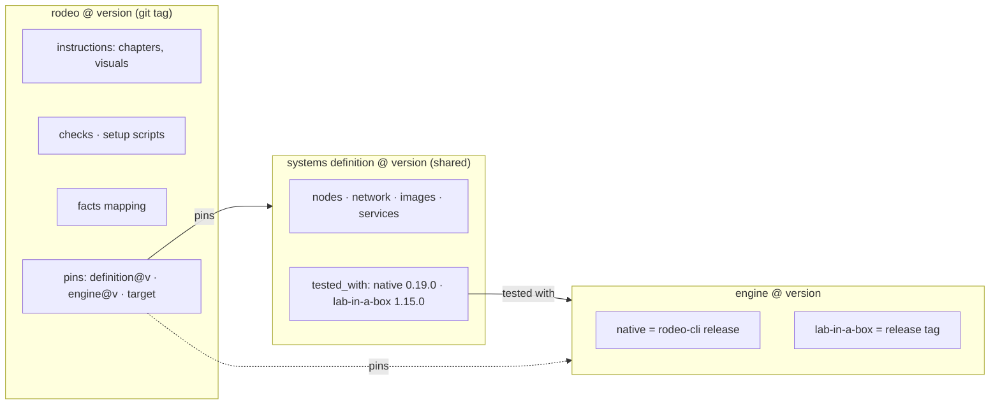
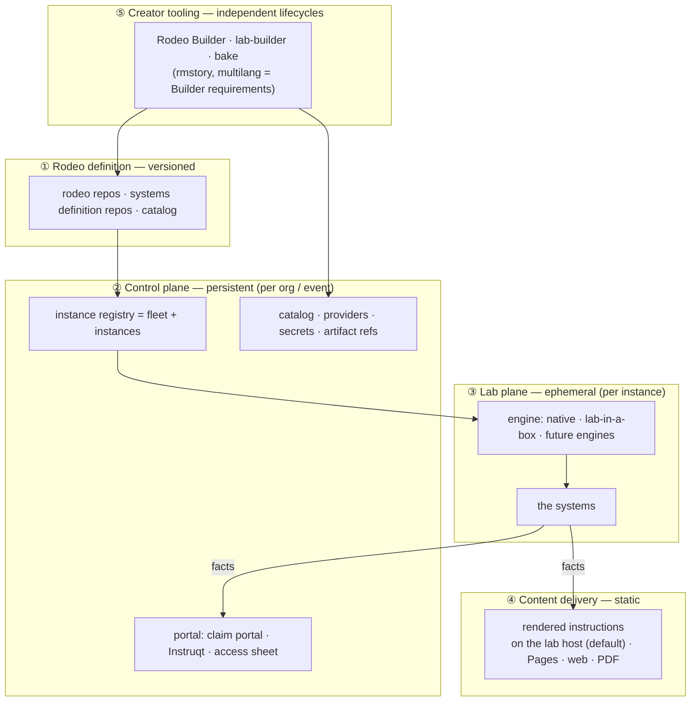
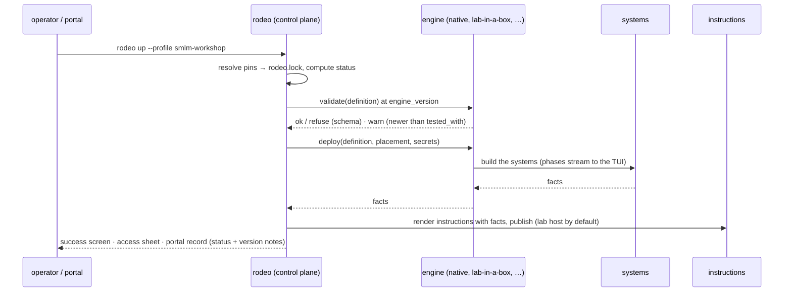

# Architecture v2 in five minutes

## The idea in one sentence

A **rodeo** is versioned instructions pinned to a versioned **systems definition**; an
**engine** (`native`, `lab-in-a-box`, or other engines integrated in the future)
materializes the definition on a platform; and
everything that is not the lab itself — portal, registry of copies, catalog, authoring
tools — lives in its own plane with its own lifecycle.

## What changes for whom

| If you… | Before | After |
|---|---|---|
| add a product platform | write a new Python pipeline (`profiles/<x>.py` + engine code) | write a systems definition (and, rarely, register one component) |
| write a workshop | `rodeo-plan.yaml` + `definition.yaml` + `story/` in one folder, no version | a rodeo repo that pins `definition@version` and `engine_version`; tag it |
| deploy | `rodeo up --profile x` | same command; a banner says **production** or **development** and whether the engine is older (refused) or newer (warning) than tested |
| operate a running lab | `status/stop/start/ssh/logs` with engine-specific branches inside | same commands, through one engine contract — identical for every engine, present or future |
| run many copies | `rodeo fleet` (per host) or `rodeo instances` (per host) | one instance registry; the claim portal, Instruqt or an access sheet show them |

## The three artifacts and how they depend on each other



- Many rodeos can pin the **same** definition. Changing a definition is a new version;
  rodeos adopt it explicitly.
- A `latest` or branch anywhere in the chain makes the rodeo **development**; all
  tags/digests make it **production**. The status is computed and shown by the Builder,
  `rodeo up`, the access sheet and the portal.
- At deploy: engine **older** than pinned → refuse; **newer** → deploy with a warning.

## The planes



Each plane can sit on a different platform. The default is colocated: the guide is
served from the lab host, the registry runs where the operator runs rodeo. **Facts**
(hostnames, URLs, ports, credentials) are the only thing that crosses out of the lab
plane — instructions template them, checks use them, the portal shows them.

## One deploy, end to end



## The native engine after the merge

```
kvm_host → vms → [ boot  |  pxe_server → cluster ] → <components: rancher, elemental, …> → apply → finalise
                   ▲ chosen from the definition's node boot method      ▲ from the definition's components list
```

`suse-virt`, `rancher`, `suse-edge` stop being pipelines and become bundled definitions.
The live-validated paths (PXE chain, etcd join gap, Rancher API order) are routed, not
rewritten, and a parity test proves every bundled example renders the same deploy
configuration before and after.

## Plan keys, old and new

```yaml
# new (v2)                                  # old (still accepted as alias)
rodeo:        {name, version}               # name:
systems:      {definition, engine,          # type:  deployment_target:
               engine_version, target,      # lab_in_a_box.source.ref / .target / .cloud / instance:
               placement}
instructions: {source, publish}             # workshop:
```

## Glossary

| Term | Meaning |
|---|---|
| **rodeo** | a workshop: versioned instructions + pins to a systems definition and an engine |
| **systems definition** | the versioned description of the systems a rodeo needs; shared, has `tested_with` |
| **engine** | what materializes a definition on a platform: `native` (rodeo-cli's merged pipeline), `lab-in-a-box`, or any engine registered later through the engine contract |
| **target / placement** | where the engine puts the systems (baremetal, Instruqt, AWS, existing host, cloud account, instance N) |
| **facts** | the values a deployed lab exposes (hosts, URLs, ports, credentials); the only contract out of the lab plane |
| **instance** | one copy of a rodeo with a placement; fleet (per host) and instances (per host slot) are the two placements |
| **status** | production (all pins resolved) or development (any `latest`/branch) — computed, never declared |
| **lock** | `rodeo.lock`: the resolved pins of one deploy |
