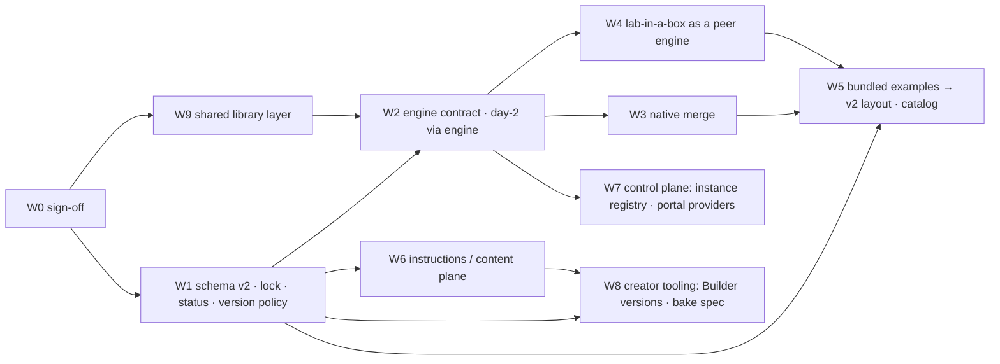

# Architecture v2 — work breakdown

Epics W0–W9. Every task names the files it creates or touches, its size, what it
depends on, and its acceptance test. **Owner** is blank on purpose: fill it in when
splitting. Size legend as in `TODO.md`: S = <10K · M = 10K–30K · L = 30K–70K ·
XL = 70K+ tokens of agent work.

Rules that apply to every task:

- New behaviour in new files; hooks into existing files are small and named.
- The bundled examples must deploy identically before and after (W5.1 is the gate
  every engine task runs against).
- No bash deploy scripts; no `time.sleep()` in loops; no AI attribution in commits.
- Old plan keys keep working (aliases, W1.2).
- Engines are peers (design decision 14): no task makes a feature work on one engine by
  routing through another, and nothing outside `rodeo/engine/<engine>` reads a
  definition's body (decision 15).

## Dependency map

Parallel tracks once W1 and W2 are in: **W3 ∥ W4 ∥ W6 ∥ W8**; W5 and W7 close them.
W9 is cross-cutting: W9.1 (layout + import rule) before W2, the extractions alongside
whichever epic touches the duplicated code.

---

## W0 — Sign-off and governance (S)

| # | Task | Files | Size | Depends | Acceptance | Owner |
|---|---|---|---|---|---|---|
| W0.1 | Review the design doc; confirm, amend or reject each proposed decision in §2 (append, don't rewrite) | `docs/design/architecture-v2.md` | S | — | both maintainers agree in the doc's decision list | |
| W0.2 | Decide portal scope (design §11.1) and instance-registry location (§11.2) | `docs/design/architecture-v2.md` | S | W0.1 | decisions recorded; W7 tasks adjusted | |
| W0.3 | Replace the "Three-axis refactor" section of the local `TODO.md` with a pointer to this breakdown | `TODO.md` (local, not committed) | S | W0.1 | — | |

## W1 — Schema v2, aliases, lock, status, version policy (M)

| # | Task | Files | Size | Depends | Acceptance | Owner |
|---|---|---|---|---|---|---|
| W1.1 | `rodeo/spec.py` (new): parse `rodeo:`, `systems:`, `instructions:` blocks into a typed `RodeoSpec`; references `name@version`, `{repo, ref}`, bundled, `./path` | `rodeo/spec.py`, `tests/test_spec.py` | M | — | every reference form round-trips; invalid forms raise `ConfigError` | |
| W1.2 | Aliases: map `type`, `deployment_target`, `workshop`, `lab_in_a_box.{source,target,cloud,…}`, `instance`, `name` onto the v2 blocks when the v2 block is absent; new keys win when both present | `rodeo/spec.py`, one hook in `rodeo/config.py:load_config` | M | W1.1 | every bundled example loads to the same `cfg` dict as before (snapshot test) | |
| W1.3 | `rodeo/versioning.py` (new): semver compare, `latest`/branch detection, `status()` = production/development over the whole chain, `check_policy(pinned, present)` → ok / warn / refuse | `rodeo/versioning.py`, `tests/test_versioning.py` | M | W1.1 | older → refuse with install hint; newer → warning text; `latest` anywhere → development | |
| W1.4 | `rodeo.lock`: write resolved pins after a successful resolve, read on later runs; `--refresh-lock` on `deploy`/`up` | `rodeo/lockfile.py` (new), hooks in `commands/deploy.py`, `commands/up_cmd.py` | M | W1.1, W1.3 | lock written 0600 beside `workshop.lock`; second run reuses it; refresh re-resolves | |
| W1.5 | Surface status and policy: banner in `rodeo up`/`deploy`, line on the success screen, `rodeo status`, `rodeo instances list`, fleet status | `rodeo/success.py`, `commands/status.py`, `instances.py`, `fleet/status.py` | S | W1.3 | development banner shown for a plan with `latest`; absent for a pinned one | |
| W1.6 | Definition envelope: `engine`, `version`, `tested_with` parsed and validated by core; the body is handed to the engine untouched (decision 15) | `rodeo/inventory.py` (read), `rodeo/spec.py`, `docs/reference/definition.md` | S | W1.1 | all optional (`engine` falls back to the plan's engine); wrong shape → `ConfigError`; an unknown body key is not an error here | |
| W1.7 | Docs: `docs/reference/plan.md` v2 blocks + alias table; `definition.md` new fields | docs | S | W1.1–W1.6 | — | |

## W2 — Engine contract and day-2 through the engine (M/L)

| # | Task | Files | Size | Depends | Acceptance | Owner |
|---|---|---|---|---|---|---|
| W2.1 | `rodeo/engine/base.py` (new): `Engine` protocol (capabilities, validate, deploy, destroy, systems, start/stop/restart, access, logs) and `Facts` dataclass; `validate()`/`deploy()` receive the definition body in the engine's own format | `rodeo/engine/base.py` | M | W1.1 | type-checked protocol; docstring = design §6 | |
| W2.2 | `rodeo/engine/registry.py` (new): `register_engine` / `get_engine`, lazy `rodeo.plugins` discovery like the other registries | `rodeo/engine/registry.py`, `tests/test_registries.py` | S | W2.1 | built-ins resolve; duplicates refused unless `replace=True`; a stub third engine registered from a test entry point resolves and passes the day-2 tests (proves the set is open) | |
| W2.3 | `NativeEngine` adapter over today's `DeployRunner` + profiles (no merge yet): implements the protocol by delegation | `rodeo/engine/native.py` (new) | M | W2.1 | all bundled native examples deploy through the adapter with identical events (test with the fake profile) | |
| W2.4 | `LabInABoxEngine` adapter over `labinabox_phase` / `labinabox_host` and the existing day-2 hooks (FQDN domains, `target.libvirt_uri`, `destroy_lab.py`, `vm_power.py`) | `rodeo/engine/labinabox_engine.py` (new) | M | W2.1 | existing lab-in-a-box tests pass unchanged through the adapter | |
| W2.5 | Day-2 commands call `get_engine(cfg).systems/start/stop/…` instead of branching on `type`: `status`, `start`, `stop`, `restart`, `start-if-needed`, `clean`, `ssh`, `logs` | `rodeo/commands/*.py` (small hooks) | L | W2.3, W2.4 | `grep -n "lab-in-a-box" rodeo/commands/` shows no engine branches; command tests unchanged | |
| W2.6 | Facts: one `Facts` produced by `deploy()`, consumed by `success.py`, `workshop.facts` rendering, the access sheet, `.labinabox/nodes.json` writer | `rodeo/engine/base.py`, `success.py`, `workshop.py`, `fleet/access.py` | M | W2.3, W2.4 | success screen and access sheet render from `Facts` only | |
| W2.7 | Docs: `docs/architecture.md` engine section + extension-points row | docs | S | W2.1–W2.6 | — | |
| W2.8 | Engine authoring guide `docs/engines.md`: the contract, the definition envelope, registration; worked through for a hypothetical AWX engine (definition = inventory + job template, `deploy` = launch job and stream its output, facts = job artifacts) — no AWX code | `docs/engines.md` (new) | S | W2.1, W2.2 | a reader can add an engine without touching any file outside `rodeo/engine/<name>/` and the registry | |

## W3 — Native engine merge (L/XL, staged)

| # | Task | Files | Size | Depends | Acceptance | Owner |
|---|---|---|---|---|---|---|
| W3.1 | Component table: `rodeo/engine/components.py` (new) with `register_component(name, step, vars_provider)`; register `rancher` (the `rodeo/engine/rancher/` package) and `elemental` | `rodeo/engine/components.py`, `tests/test_components.py` | M | W2.3 | components resolve by name; unknown component → `ConfigError` at validate | |
| W3.2 | Boot-method derivation: `[boot | pxe_server → cluster]` chosen from `inventory.pxe.nodes` | `rodeo/engine/native.py` | M | W3.1 | `rancher` and `suse-edge` derive `boot`; `suse-virt` derives `pxe_server → cluster`; `test` (2-node, no Rancher) derives no `rancher` step | |
| W3.3 | Vars split: each component contributes its vars; `_write_vars_file()` becomes the union; Harvester checksums move to the harvester/cluster component | `rodeo/engine/components.py`, `rodeo/engine/runner.py` (shrink), `tests/test_ansible_vars_contract.py` | L | W3.1 | rendered vars file byte-identical for every bundled example (W5.1 gate) | |
| W3.4 | Stage 1 — `rancher` and `rancher-test` through the merged pipeline; their profile classes become definitions + defaults | `rodeo/profiles/rancher.py`, `rancher_test.py`, `rodeo/data/platforms/rancher*/` | M | W3.2, W3.3 | W5.1 gate green; `tests/test_runner.py`, `test_stream_boot.py` unchanged | |
| W3.5 | Stage 2 — `suse-edge` (adds the `elemental` component) | `rodeo/profiles/suse_edge.py` | M | W3.4 | gate green; `test_success.py` edge sections unchanged | |
| W3.6 | Stage 3 — `suse-virt` (PXE/cluster path; etcd gap; `harvester_auto_import`) — last and alone | `rodeo/profiles/suse_virt.py` | L | W3.5 | gate green; `test_pxe_integration.py`, `test_cluster.py`, `test_ansible_consistency.py` unchanged; **live regression on bare metal before merge** | |
| W3.7 | Unify dispatch: delete `ansible_phases` frozenset + `_STREAM_PHASES` special case in favour of the component table; `register_stream_phase` kept as a deprecated shim | `rodeo/profiles/base.py`, `rodeo/engine/native.py` | M | W3.6 | `tests/test_registries.py` stream-phase tests pass via the shim | |
| W3.8 | Docs: `CONTEXT.md` architecture map, `docs/architecture.md` phases, ROADMAP note | docs | S | W3.7 | — | |

## W4 — lab-in-a-box as a peer engine behind the contract (M)

Scope: the existing lab-in-a-box integration becomes one engine among several behind
the contract, keeping its own definition format and the capabilities only it has today
(add-on catalogue, cloud targets, remote automation host). Nothing in W4 makes
lab-in-a-box the default or routes native features through it; creating the `native`
engine from today's pipelines is W3.

| # | Task | Files | Size | Depends | Acceptance | Owner |
|---|---|---|---|---|---|---|
| W4.1 | `engine_version` → resolved lab-in-a-box release; `latest` resolution recorded in the lock; W1.3 policy applied against the installed checkout | `rodeo/labinabox_host.py`, `rodeo/engine/labinabox_engine.py` | M | W2.4, W1.4 | pinned older than installed → refuse; newer installed → warning; `latest` → development | |
| W4.2 | `capabilities()`: targets (managed host, existing local/remote host, 8 cloud backends) and system kinds from the installed `lab_schema`/`components` API | `rodeo/engine/labinabox_engine.py`, `rodeo/builder/discovery.py` (reuse `_LIAB_COMPONENTS`) | M | W2.4 | Builder and preflight read the same capability data | |
| W4.3 | Definition: the `lab_in_a_box.nodes/images/sections/variants/…` keys become the body of a lab-in-a-box systems definition (the engine's own format, alias-backed; a `lab.json` body per Builder F2 fits the same slot) | `rodeo/labinabox.py`, `rodeo/spec.py` | M | W1.2 | rendered `lab.json` byte-identical for `smlm-workshop` (W5.1) | |
| W4.4 | Tests: adapter + policy + capabilities | `tests/test_labinabox_engine.py` (new) | M | W4.1–W4.3 | — | |

## W5 — Bundled examples to the v2 layout; catalog (M/L)

| # | Task | Files | Size | Depends | Acceptance | Owner |
|---|---|---|---|---|---|---|
| W5.1 | **The gate**: `tests/test_render_parity.py` renders the deploy configuration (vars file, inventory, `lab.json`) for every bundled example from the pre-change tree (fixtures) and the current tree, and diffs | `tests/test_render_parity.py`, `tests/fixtures/render_parity/` | M | W1.2 | fixtures captured on `main` before any engine change; test fails on any drift | |
| W5.2 | Split each example into a bundled systems definition for its engine + thin rodeo (`rodeo:` + `systems:` blocks); `PROFILE_EXAMPLE` keeps every current name | `rodeo/data/platforms/`, `rodeo/data/examples/`, `rodeo/labseed.py` | L | W5.1, W3.7, W4.3 | gate green; `rodeo up --profile <every name>` seeds the same files (`_verify_seed_copy`) | |
| W5.3 | `engine` and `tested_with` filled for every bundled definition with the versions validated live (from ROADMAP/CHANGELOG records) | `rodeo/data/platforms/*/definition.yaml` | S | W5.2 | status = production for all bundled rodeos | |
| W5.4 | Catalog (Builder F4): `rodeo/data/catalog.d/<name>.yaml` + `rodeo new <name> --from-repo <url>[@ref]`; `--profile` resolves bundled → `~/.rodeo/profiles` → catalog; fetched at `ref` into `~/.rodeo/vendor/rodeos/<name>/<commit>` | `rodeo/catalog.py` (new), `rodeo/labseed.py`, `rodeo/profile_install.py` | L | W1.4 | a catalog rodeo deploys and its commit lands in `rodeo.lock` | |
| W5.5 | Workshop rodeos (`virt-workshop-aws*`, `smlm-workshop`) published as content repos + catalog entries; bundled copies kept one release | content repos, `catalog.d/` | M | W5.4 | both paths deploy identically | |

## W6 — Instructions / content plane (M/L)

| # | Task | Files | Size | Depends | Acceptance | Owner |
|---|---|---|---|---|---|---|
| W6.1 | `instructions.source` with formats `rmstory | instruqt | markdown`; one fetch step for every engine (today only `labinabox_phase` fetches `workshop:`) | `rodeo/workshop.py` → `rodeo/content.py` (new, old module kept as alias) | M | W1.1 | native labs can carry a track too; `workshop:` alias still works | |
| W6.2 | `instructions.publish`: `lab` (serve `<lab>/workshop-guide/` from the lab host — nginx on native, HTTP service on lab-in-a-box), `pages`, `url`, `pdf` | `rodeo/content.py`, kvm_host/nginx hook, `success.py` | L | W6.1, W2.6 | guide reachable at the URL shown on the success screen in each mode | |
| W6.3 | Content-shipped `setup/` and `checks/` run after deploy through `Engine.access()` (Builder F7) | `rodeo/content.py`, `rodeo/engine/base.py` | M | W2.6 | checks run against every registered engine (today native and lab-in-a-box) without engine-specific code | |
| W6.4 | Facts contract documented: the full list of facts an engine must provide, with the templating syntax | `docs/reference/facts.md` (new) | S | W2.6 | — | |

## W7 — Control plane: instance registry and portal providers (L; shape depends on W0.2)

| # | Task | Files | Size | Depends | Acceptance | Owner |
|---|---|---|---|---|---|---|
| W7.1 | Instance registry: one model for "a copy of a rodeo with a placement" covering fleet hosts (`workshop.yaml` `hosts[]`) and per-host instances (`instance: N`); per-copy variation limited to names, network, ports, secrets | `rodeo/registry.py` (new), `rodeo/instances.py`, `rodeo/fleet/inventory.py` | L | W2.6, W0.2 | `rodeo instances list` and `rodeo fleet status` read the same registry | |
| W7.2 | Portal providers: `claim-portal` (existing `rodeo/portal/`, `fleet/portal.py`), `instruqt`, `access-sheet`; the registry publishes facts to the selected provider | `rodeo/fleet/portal.py`, `rodeo/fleet/access.py`, `rodeo/portal_providers.py` (new) | M | W7.1 | claim portal receives the same lab records as today (`portal_publish` tests) | |
| W7.3 | Status and version policy visible per instance in the registry, the access sheet and the claim portal | `rodeo/portal/web.py`, `fleet/access.py` | S | W1.5, W7.1 | development instances are marked | |
| W7.4 | Docs: `docs/fleet.md` and `docs/claim-portal.md` cross-references | docs | S | W7.1–W7.3 | — | |

## W8 — Creator tooling (M)

| # | Task | Files | Size | Depends | Acceptance | Owner |
|---|---|---|---|---|---|---|
| W8.1 | Builder writes `rodeo.version`, `systems.definition@version`, `systems.engine_version` and the definition's `tested_with` with the versions in use; shows production/development status per dependency | `rodeo/builder/api.py`, `htdocs/app.js`, `logic.js`, `tests/test_builder.py` | M | W1.3 | generated zips are production when every pin resolves; `latest` shows the development banner | |
| W8.2 | rmstory + multilang declared as Builder requirements (pinned) in the package extras; Builder refuses to run translate/validate with a mismatched version | `pyproject.toml` (`[builder]` extra), `rodeo/storydeps.py`, `rodeo/builder/server.py` | S | — | version check at server start; hint names the pinned versions | |
| W8.3 | Bake as an engine-agnostic spec: `bake.yaml` (input definition subset + build steps + export), the current `smlm-workshop/bake/` scripts as its first implementation; output manifest with sha256 consumed via the definition's images | `docs/design/bake.md` (new), `rodeo/data/examples/smlm-workshop/bake/` | M | W1.6 | a baked image referenced by digest makes the rodeo production | |
| W8.4 | Overview and reference docs updated; `docs/design/architecture-v2*.md` marked implemented per epic | docs | S | all | — | |

## W9 — Shared library layer (cross-cutting; design §6.1)

| # | Task | Files | Size | Depends | Acceptance | Owner |
|---|---|---|---|---|---|---|
| W9.1 | Create `rodeo/lib/` and the import-direction rule: nothing under `rodeo/lib/` imports `rodeo.engine`, `rodeo.commands`, `rodeo.fleet`, `rodeo.portal`, `rodeo.builder`; audit the design §6.1 table against the tree | `rodeo/lib/__init__.py`, `tests/test_lib_imports.py` | S | W0.1 | the import test passes and fails on a deliberate violation | |
| W9.2 | `lib/sshargv.py`: one builder (options, identity, host-key policy pinned/accept-new, ProxyJump); the six call sites call it (old names re-exported) | `rodeo/lib/sshargv.py`, call sites | M | W9.1 | argv per call site byte-identical (snapshot test) | |
| W9.3 | `lib/fetch.py`: download-and-verify (resume, `curl -4`, sha256/sha512, verified-marker cache) replacing the five copies | `rodeo/lib/fetch.py`, call sites | M | W9.1 | image/story/deps tests unchanged; one injectable `run=` | |
| W9.4 | `lib/stream.py`, `lib/versions.py`, `lib/statefile.py`, `lib/secrets.py` extracted as W1/W2 touch the code | `rodeo/lib/*.py` | M | W1, W2 | callers unchanged in behaviour; library functions unit-tested without a host | |
| W9.5 | CLAUDE.md "Reusability" table and `docs/architecture.md` point at `rodeo/lib/` | docs | S | W9.2–W9.4 | — | |

---

## Suggested split

Two independent lanes after W0 and W1 (W1 is small enough for one person to do first):

- **Lane A — engines**: W2 → W3 (native merge, needs the bare-metal live regression for
  W3.6) → W5.1–W5.3.
- **Lane B — platform and content**: W4 (lab-in-a-box as a peer engine) → W6 → W8;
  W7 once W0.2 is decided.

W5.4–W5.5 (catalog, content repos) can be picked by whichever lane finishes first.
W9 belongs to both lanes: each extraction goes with the epic that first needs it.
