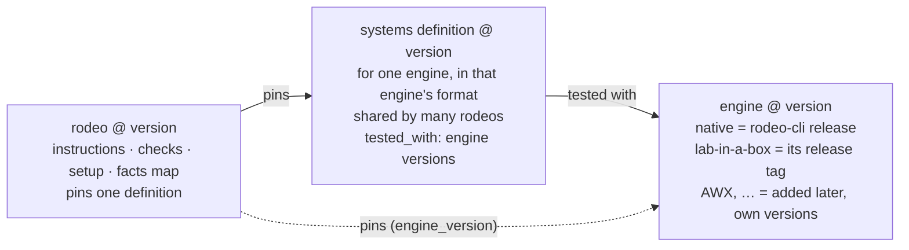

# Architecture v2 — engines, versioned artifacts, planes

## 1. Problem

rodeo-cli deploys the systems of a workshop ("rodeo") with one Python pipeline per
product platform: `suse-virt`, `rancher` and `suse-edge` are three separate deploy
mechanisms (`rodeo/profiles/*.py` + `rodeo/engine/*`), each hardcoding its phase list
and its product steps. There is no "engine" today, only these pipelines. A fourth
platform (telco-cloud in ROADMAP Phase G) means a fourth pipeline. That growth — one
pipeline per product mix — is not sustainable.

A second deploy mechanism also exists: `type: lab-in-a-box` hands the deploy to
lab-in-a-box, which brings capabilities the three pipelines do not have (its add-on
catalogue, cloud targets, a remote automation host). It was bolted on as a special
`type`, with its own branches in the day-2 commands. There is no general way to add a
third mechanism — AWX running job templates, for instance — without repeating that
pattern.

This proposal names the mechanism an **engine**, merges the three pipelines into one
engine called `native`, puts lab-in-a-box behind the same contract as a second engine,
and leaves the set open.

Three further gaps compound it:

| Gap | Where | Effect |
|-----|-------|--------|
| Instructions and the systems they run on are not versioned together | `workshop:` block fetches a track by branch; `definition.yaml` has no version | a definition change silently breaks the exercises written against it |
| Engines and tools are referenced by "latest" | `lab_in_a_box.source.ref: latest`; Builder uses whatever is installed | a rodeo that worked yesterday deploys differently today |
| Multiplicity and access are three separate mechanisms | `rodeo fleet` (one lab per host), `rodeo instances` (many labs per host), the claim portal | the same concept — copies of a rodeo — has three vocabularies and no shared registry |

## 2. Decisions proposed (Raúl, 2026-10-14; 14–15 added 2026-10-15; to be confirmed with Andrés in W0.1)

1. The three native pipelines merge into **one engine, `native`**. New products become
   definitions, never new engines.
2. An engine **materializes a systems definition** (a set of predefined systems). No
   add-on-picker semantics in the engine; what runs is what the definition declares.
3. A rodeo has two attendee-facing components — **instructions** and the **systems lab**
   — plus **auxiliary tools**. The components are separated by lifecycle, and each can
   be deployed on a different platform; default is the same platform.
4. **Systems definitions are shared** between rodeos and are versioned on their own.
   A rodeo pins one definition version. Git-hosted content follows the same tag/pin
   versioning.
5. `latest` / branch references are allowed, but any artifact that contains one is in
   **development** status; fully pinned artifacts are **production**. Creator tools
   show the status.
6. Compatibility ("definition X was tested with engine Y") is recorded on the
   definition. **UI tools fill in the current versions automatically**; in a
   hand-written file the field is optional.
7. Version policy at deploy: **older than pinned → refuse; newer → deploy with a
   warning** ("not the tested/production version").
8. **rmstory and multilang are the Rodeo Builder's own library requirements**, pinned
   like any dependency. lab-builder (lab-in-a-box's web UI) and similar tools are
   separate projects with independent lifecycles; whoever integrates them pins a version.
9. **Day-2 and checks work independently of the engine** that deployed the systems.
10. **Bundled examples are transformed** to the new layout but **must keep working as
    they do today — they are in production.**
11. Old plan keys stay as **aliases** for at least one release.
12. The attendee portal's scope (own portal vs Instruqt vs access sheet, beyond the
    existing claim portal) is **left for discussion with Andrés**.
13. **Reusability**: small, typed, tested functions live in one shared library layer
    (`rodeo/lib/`) that every engine, command and tool imports; engines and tools never
    import each other. Existing duplicated helpers are consolidated there as the epics
    touch them (§6.1).
14. **Engines are peers and the set is open.** `native` and `lab-in-a-box` are two
    engines behind one contract; others (AWX, for example) are added the same way. The
    purpose is to make the engine **modular** — not to make lab-in-a-box, or any other
    engine, the only one. `native` (the merge of today's pipelines, decision 1) is
    rodeo-cli's own engine and keeps being developed on its own roadmap; lab-in-a-box
    is the engine to pick when a rodeo needs capabilities `native` does not offer at
    the time. An engine offers the capabilities it has;
    a rodeo picks the engine whose capabilities it needs.
15. **A systems definition is written for one engine, in that engine's format.** What
    happens inside an engine is the engine's business; what matters is that a lab can
    be defined for the chosen engine and deployed by it. rodeo-cli handles only the
    common envelope (`name`, `version`, `engine`, `tested_with`) and passes the body to
    the engine, which validates it. A definition for engine A and one for engine B may
    look nothing alike.

## 3. Goals and non-goals

**Goals**

- Add a product platform by writing a systems definition for the engine of your
  choice, not a pipeline.
- Engines are interchangeable at the contract, never in their internals: adding,
  choosing or upgrading an engine touches no command, check or tool outside the engine
  (decision 14).
- A rodeo pins everything it needs; a production rodeo deploys the same way every time.
- One engine contract that day-2 commands, checks, the Builder and the control plane
  program against, with no engine-specific branches outside the engine.
- Instructions, systems and auxiliary tools placeable on different platforms.
- One implementation per concern: SSH argv, download-and-verify, subprocess
  streaming, version compare, lock/state files, secrets I/O live in `rodeo/lib/` and
  are reused by every engine and tool (§6.1).
- Every stage of the migration keeps the bundled examples working and the test suite
  green; the live-validated code paths (PXE chain, etcd join gap, Rancher API order,
  `CONTEXT.md` "do not modify" table) move behind the new dispatch byte-for-byte.

**Non-goals**

- A shell/bash automation backend (ROADMAP: no bash deploy scripts). Scripts that
  ship with content already run through the `custom_scripts` phase and lab-in-a-box
  add-ons.
- Making any engine *the* engine. lab-in-a-box is not the successor of today's
  pipelines or of the `native` engine they merge into, and `native` is not frozen: each
  keeps its own roadmap. Cloud-direct labs are a
  lab-in-a-box capability today (`lab_in_a_box.cloud`, 8 providers) while ROADMAP
  Option A keeps `native` KVM-first; which capabilities an engine grows next is that
  engine's decision, not this design's.
- Rewriting the portal. The Fleet claim portal (`docs/claim-portal.md`) is the
  existing control-plane portal; this design places it, it does not replace it.
- Deciding the portal roadmap (decision 12).

## 4. Concepts

### 4.1 The three components of a rodeo

| Component | Consumed by | Lifecycle | Produced by |
|---|---|---|---|
| **Instructions** — chapters, visuals, checks, exercise setup | attendees | static, versioned | authors → rodeo repo |
| **Systems lab** — the real systems attendees connect to | attendees | ephemeral, per instance | an engine, from a systems definition |
| **Auxiliary tools** — portal, Builder, fleet/instances, bake, day-2 | operators, authors, attendees | persistent or developer-side | tooling, never per-rodeo |

### 4.2 The three governed artifacts



- **Systems definition** — what systems exist, **written for one engine in that
  engine's format** (decision 15): today's `definition.yaml` for `native`; the
  lab-in-a-box lab (`lab_in_a_box.nodes/images/sections`, or a `lab.json`, Builder F2)
  for `lab-in-a-box`; whatever a future engine takes (an inventory plus a job template
  for an AWX engine). The envelope is the same for every engine — `name`, `version`,
  `engine`, `tested_with` (decision 6) — and is all rodeo-cli reads; the body goes to
  the engine untouched. Own version, own repo or catalog entry; bundled definitions
  carry rodeo-cli's version.
- **Rodeo** — instructions, checks, setup scripts, facts mapping, and the pins: one
  definition version, the engine and its version, target defaults. A rodeo repo is
  today's profile directory (`rodeo-plan.yaml`, `story/`, `checks/`, `custom/`).
- **Engine** — versioned by its own project. rodeo-cli *is* the version of `native`;
  lab-in-a-box has its release tags; a future engine brings its own.
- **Lock** (`rodeo.lock`, in the lab dir like today's `workshop.lock`) — the resolved
  pins at deploy/publish time: definition version + commit, engine version, image
  digests, content commit, computed status.

### 4.3 Planes (separation by lifecycle)

```mermaid
flowchart TB
  subgraph GOV["Rodeo definition — versioned (git tags)"]
    RD["rodeo repo: instructions + pins + lock"]
    SD["systems definition repo / catalog entry"]
  end
  subgraph CP["Control plane — persistent, per organization or event"]
    PORTAL["portal: claim portal (existing) · Instruqt · access sheet"]
    REG["instance registry (fleet + instances unified)"]
    CAT["catalog · providers · secrets custody · artifact refs"]
  end
  subgraph LP["Lab plane — ephemeral, per instance"]
    ENG["engine: native · lab-in-a-box · AWX · … (peers)"]
    SYS["the systems"]
  end
  subgraph CD["Content delivery — static"]
    GUIDE["rendered instructions: on the lab host (default) · Pages · web · PDF"]
  end
  subgraph CT["Creator tooling — independent lifecycles, pinned"]
    BLD["Rodeo Builder (rmstory, multilang as its requirements)"]
    LB["lab-builder (lab-in-a-box)"]
    BAKE["bake: image artifacts by digest"]
  end
  RD --> REG
  SD --> ENG
  REG -- "deploy(definition, placement, secrets)" --> ENG
  ENG --> SYS
  SYS -- "facts" --> GUIDE
  SYS -- "facts" --> PORTAL
  BLD --> RD
  LB --> SD
  BAKE --> CAT
```



| Plane | Lifecycle | Holds | Platform |
|---|---|---|---|
| Rodeo definition | versioned | rodeo repos, systems definition repos, catalog | git hosting |
| Control plane | persistent | portal (pluggable), instance registry, catalog, providers, secrets custody, artifact references, engine clients | a small always-on host or service; Instruqt can play this role |
| Lab plane | ephemeral | the systems of one instance | whatever the pinned engine supports |
| Content delivery | static | rendered instructions for one rodeo version + facts | default: the lab host; else Pages, any web host, PDF |
| Creator tooling | independent | Builder, lab-builder, rmstory/multilang, bake | developer-side or CI |

### 4.4 Where today's tools land

| Tool | Today | Plane | Notes |
|---|---|---|---|
| Rodeo Builder (`rodeo/builder/`, static page, `rodeo builder` server) | authoring | creator tooling | fills definition/engine versions and shows status (decisions 5, 6) |
| lab-builder + MCP (lab-in-a-box) | authoring, remote deploy | creator tooling / control plane client | separate project, pinned by its integrator |
| rmstory, multilang | story rendering, i18n | creator tooling | Builder requirements (decision 8); only their output is in the rodeo |
| `rodeo fleet` (`rodeo/fleet/`) | one lab per host over SSH, access sheet | control plane: instance registry | per-copy variation bounded to names, network, ports, secrets |
| `rodeo instances` (`rodeo/instances.py`) | many labs per host | control plane: instance registry | same concept as fleet with a different placement |
| Claim portal (`rodeo/portal/`, `rodeo/fleet/portal.py`, `docs/claim-portal.md`) | students claim their lab | control plane: portal | passive VM; already the portal of this architecture |
| Host providers (`rodeo/providers/`, lab-in-a-box backends) | acquire machines | engine capability | the set of platforms is a property of the engine |
| Bake (`smlm-workshop/bake/`) | pre-built SMLM image via lab-in-a-box | creator tooling | engine-agnostic by contract: input = definition subset + build steps, output = image + manifest + sha256 |
| Day-2 (`status`, `start/stop/restart`, `clean`, `ssh`, `logs`, `doctor`) | works for the two current engines through branches | lab plane, via the engine contract | §6 |
| Checks (`checks/check-<id>.sh`, chapter `needs`) | in profiles | rodeo definition, run via the engine contract | Builder F7 |
| Catalog (Builder F4, `rodeo/data/catalog.d/`) | planned | control plane / rodeo definition | distribution of rodeos and definitions |
| Instruqt | portal + lab host | control plane (portal provider) and lab plane (target) | encapsulated as a provider on both planes |

## 5. Versioning and governance

### 5.1 Identifiers

Every reference is `<name>@<version>` where `version` is a tag, a commit, a digest,
or `latest`. Sources: a bundled artifact (versioned with rodeo-cli), a git repo
(`{repo, ref}`), or a catalog entry (name → repo + ref).

### 5.2 Status (computed, never declared)

- **production** — every reference in the chain rodeo → definition → engine → images
  → content is a tag, commit or digest.
- **development** — any reference is `latest` or a branch.

Shown by: the Builder (banner on the rodeo and on each dependency), the catalog
listing, `rodeo up` (banner before deploy, line on the success screen), the access
sheet, `rodeo instances list`, fleet status. A policy such as "catalog entries used
for events must be production" is a control-plane rule, not an engine rule.

### 5.3 Version policy at deploy

For each pinned dependency, compare the pinned version with what is actually present
(the installed rodeo-cli, the resolved lab-in-a-box release, the engine range a
definition declares in `tested_with`):

| present vs pinned | behaviour |
|---|---|
| older | refuse, naming the pinned version and how to install it |
| equal | deploy |
| newer | deploy; warn "`<engine> <present>` is newer than the tested/production `<pinned>`" (printed, logged, repeated on the success screen) |

Missing `tested_with` (hand-written definition, decision 6): no comparison, no warning.

### 5.4 Compatibility authority

Two checks, different roles:

- **Schema check — hard gate.** The engine validates the definition against its own
  schema at the pinned engine version (`lab_schema` today for lab-in-a-box;
  `validate_config` + inventory rules for native). Unknown fields or missing required
  fields refuse the deploy. rodeo-cli itself reads only the envelope (`name`,
  `version`, `engine`, `tested_with`); the body is the engine's (decision 15).
- **Tested-with — warning source.** The definition's `tested_with` records the engine
  versions it was validated against. The Builder and lab-builder write the versions in
  use when they save; a hand-edited file may omit it.

### 5.5 The lock

`rodeo.lock` lives next to the lab's state (where `workshop.lock` lives today) and is
written at the end of a successful resolve: definition `{name, version, commit}`,
engine `{name, version}`, images `{name: sha256}`, content `{repo, ref, commit}`,
`status`, `resolved_at`. `rodeo status` and `rodeo instances list` read it; a second
deploy of the same lab dir reuses it unless `--refresh-lock`.

## 6. Engine contract

A new `rodeo/engine/base.py` declares the protocol every engine implements; the
registry maps `systems.engine` to an implementation (built-ins `native` and
`lab-in-a-box`; plugins via `rodeo.plugins`).

Engines are peers (decision 14). The contract is the whole boundary: an engine receives
a definition in its own format, a placement and secrets, and gives back an event stream
and facts. How it gets there — Ansible over libvirt (`native`), lab-in-a-box's
`setup_lab.py` on an automation host, AWX job templates, something else — is invisible
to everything outside the engine, and no engine is routed through another. `native`
stays rodeo-cli's own engine and keeps growing (§7); `lab-in-a-box` is the engine to
pick when its capabilities are needed (add-on catalogue, cloud targets, remote host); an
AWX engine would be the one to pick for labs already expressed as job templates. Adding
an engine is one module plus a registry entry; it changes nothing else.

```
Engine (name, version)
  capabilities()                       → targets it supports, system kinds it builds
  validate(definition, plan)           → hard schema gate; the body is in the engine's own format
  deploy(definition, placement, secrets) → DeployEvent stream; returns Facts
  destroy(instance)
  systems(instance)                    → [(name, state)]        ┐
  start / stop / restart(system)                                ├─ day-2 uses only these
  access(system)                       → ssh target or console  │
  logs(system)                                                  ┘
```

**Facts** are the only thing that leaves the lab plane: hostnames, URLs, ports,
credentials, kubeconfig locations (`workshop.facts`, the success screen and
`.labinabox/nodes.json` are today's partial forms). Instructions template them,
checks reach systems through `access()` with them, the portal and access sheet show
them. Nothing outside an engine reads engine internals.

The event stream stays what it is today (`PhaseStarted`, `LogLine`, …) so the TUI
and plain mode are untouched.

### 6.1 Shared library layer (reuse across engines and tools)

Engines, commands, fleet, the portal and the Builder share one library layer,
`rodeo/lib/`, of small, typed, side-effect-light functions with their own unit tests.

Rules:

- **Dependency direction** `lib ← engine ← commands / fleet / portal / builder`. Nothing
  in `rodeo/lib/` imports from engines or tools; a test enforces it (W9.1).
- **One implementation per concern.** A function enters `rodeo/lib/` when a second caller
  needs it; it is *moved*, not copied, and the old location becomes a one-line re-export
  for the alias period.
- **No console output, no `SystemExit`** in the library: it raises typed errors
  (`ConfigError`, …) and the caller decides how to report.
- **Pure where possible**: inputs in, result out; subprocess/network/file I/O behind
  injectable `run=` / `fetch=` parameters so tests need no host (the pattern
  `storydeps.install_story_deps(run=…)` already uses).

Concerns written more than once today (the W9 audit starts from this table):

| Concern | Today lives in | Target |
|---|---|---|
| SSH options and argv (host-key policy, identity, ProxyJump) | `ssh.py`, `ssh_targets.py`, `labinabox_host.py`, `engine/labinabox_phase.py`, `fleet/ssh_exec.py`, `commands/pull_edge_image_cmd.py` | `lib/sshargv.py` |
| Download + verify (resume, `curl -4` on Instruqt, sha256/sha512, verified-marker cache) | `labinabox_host.py`, `storydeps.py`, `commands/install_deps.py`, `awscli.py`, `engine/labinabox_phase.py` | `lib/fetch.py` |
| Subprocess streaming (tee to the plan log, cancel via process group) | `engine/runner.py` | `lib/stream.py` |
| Version parse and compare | `commands/self_update_cmd.py` | `lib/versions.py` (W1.3 builds on it) |
| Secrets read/write (0600, `??key` resolution, per-lab override) | `config.py`, `secretgen.py` | `lib/secrets.py` |
| Lock and state files (0600, atomic write) | `state.py`, `workshop.py`, `instances.py` | `lib/statefile.py` |

## 7. The native engine (merging the three pipelines)

The three native pipelines differ in exactly two data-expressible ways:

| Difference | Expressed by | Today |
|---|---|---|
| Boot method: image boot (`boot`) vs iPXE install with VIP/etcd waits (`pxe_server → cluster`) | nodes' boot method in the definition (`inventory.build_inventory()` already computes `pxe.nodes`) | hardcoded per profile |
| Product steps: `rancher`, `elemental`, (`workloads` for telco) | the definition's `components:` list, in order | hardcoded per profile, dispatched via `_STREAM_PHASES` |

`native` therefore runs:

```
kvm_host → vms → [ boot | pxe_server → cluster ] → <component steps…> → apply → finalise
```

with the bracket and the component list read from the definition. Component steps are
Python modules (today's `rodeo/engine/rancher/` package, `elemental`) registered in a
component table; no bash. The Harvester-specific `_write_vars_file()` is split so each
component contributes its own vars, which is what lets the engine stop carrying product
data at its top level. The profile classes `rancher`, `suse_virt`, `suse_edge`,
`rancher_test` become bundled definitions with defaults; `RodeoProfile` remains as the
compatibility shim for `type:` (§8).

The merge is how `native` keeps growing — by definitions and components, not by
pipelines. It remains under active development: new components (telco workloads), boot
methods or targets land in `native` without any other engine being involved.

The lab-in-a-box engine wraps today's `labinabox_host` / `labinabox` / `custom_scripts`
phases and the existing day-2 hooks (FQDN domains, `target.libvirt_uri`,
`destroy_lab.py`, `vm_power.py` for cloud) behind the same contract. It is the second
peer engine, not an alternative to the merge; its definition format is lab-in-a-box's
own (W4.3).

## 8. Plan and definition schema v2, with aliases

New top-level keys in `rodeo-plan.yaml`:

```yaml
rodeo:
  name: smlm-workshop
  version: 1.2.0                 # the rodeo's own version (tag); omitted = development
systems:
  definition: smlm-base@1.0.0    # bundled name, name@version, {repo, ref}, or ./definition.yaml
  engine: native                 # native | lab-in-a-box | any engine registered later;
                                 # must match the definition's engine; may be omitted
  engine_version: 0.19.0         # tag or latest (latest = development status)
  target: baremetal              # engine-specific: baremetal | instruqt | aws | …
  placement: {}                  # engine-specific: existing host, cloud account, instance N
instructions:
  source: ./story                # or {repo, ref, format: rmstory|instruqt|markdown}
  publish: lab                   # lab (default, colocated) | pages | url | pdf
```

New keys in the envelope of a systems definition (the body below them is the engine's):

```yaml
engine: native                   # the engine this definition is written for
version: 1.0.0
tested_with: [0.19.0]            # versions of that engine it was validated against
```

`engine` defaults to the plan's `systems.engine` (or the `type:` alias) when absent;
`version` and `tested_with` are optional.

Aliases (kept for at least one release; a plan may mix old and new keys, new wins):

| Old key | Meaning in v2 |
|---|---|
| `type: suse-virt \| rancher \| suse-edge \| rancher-test` | `systems.engine: native` + the bundled definition of that name |
| `type: lab-in-a-box` | `systems.engine: lab-in-a-box` + a lab-in-a-box definition built from the `lab_in_a_box.*` keys |
| `deployment_target:` | `systems.target` |
| `lab_in_a_box.source.{repo,ref}` | `systems.engine_version` (+ source override) |
| `lab_in_a_box.target`, `.cloud`, `.instance`/`instance:` | `systems.placement` |
| `lab_in_a_box.nodes`, `.images`, `.sections`, `.variant(s)`, `.root_password`, `.dns_aliases`, `.parallel` | the body of a lab-in-a-box systems definition |
| `workshop: {repo, branch/ref, track, facts, replace, pdf}` | `instructions.source` (format `instruqt`) + facts mapping |
| `name:` | `rodeo.name` |

`resources`, `network`, `versions`, `storage`, `libvirt`, `credentials`,
`operator_secrets`, `ansible` are unchanged.

## 9. Bundled examples: transformed, and still working

The bundled profiles (`rancher-test`, `rancher`, `test`, `harvester-ha`, `harvester-2n`,
`harvester`, `virt-workshop-aws`, `virt-workshop-aws-2n`, `suse-edge`, `smlm-workshop`)
are in production. The transformation rule is therefore:

1. Each example splits into a **bundled systems definition for its engine** (`native`:
   `rancher`, `harvester`, `harvester-2n`, `harvester-ha`, `test`, `suse-edge`;
   `lab-in-a-box`: `smlm-base`) and a **thin bundled rodeo** that pins it. Workshop rodeos
   (`virt-workshop-aws*`, `smlm-workshop`) later move to content repos as catalog entries
   (Builder F4), keeping a bundled copy for one release.
2. The aliases of §8 make the untouched old files load identically; the transformed
   files must produce the **same rendered deploy configuration** (Ansible vars file,
   inventory, `lab.json`) as before. A test renders both forms for every bundled example
   and diffs them — the same gate PR #4 used when profiles were standardized.
3. `rodeo up --profile <name>` keeps every current name; `PROFILE_EXAMPLE` in
   `rodeo/labseed.py` resolves to the new layout.
4. Existing tests stay unmodified except where a key is renamed in a fixture; the drift
   guards (`tests/test_ansible_consistency.py`, `tests/fixtures/labinabox_schema/`) keep
   pinning the live-validated chains.

## 10. Migration — non-disruptive stages

Each stage merges on its own with the suite green and no behaviour change for existing
plans. Ordering between W-epics is in the work breakdown.

1. **Name the seams.** Schema v2 keys + aliases, status computation, `rodeo.lock`,
   version policy — no engine code touched yet.
2. **Engine contract.** `rodeo/engine/base.py` + registry; day-2 commands call the
   engine instead of branching on `type`. Both existing engines (`native`,
   `lab-in-a-box`) implemented as thin adapters over today's code; a third engine is one
   module plus a registry entry.
3. **Native merge, one profile at a time.** `rancher` first (image boot + one
   component), then `suse-edge`, then `suse-virt` last (PXE/cluster is the
   regression-sensitive path). Each step gated by the byte-identical render test.
4. **Bundled examples to the v2 layout** (definitions + thin rodeos) behind the same
   gate; `type:` becomes an alias only.
5. **Instructions and control plane.** `instructions.publish`, content pass-through
   (Builder F2/F6/F7), instance registry unifying fleet and instances, portal providers.
6. **Creator tooling.** Builder writes versions and shows status; bake specified as an
   engine-agnostic pipeline.

## 11. Open questions

1. **Portal scope** (decision 12) — the claim portal is the existing control-plane
   portal; whether an "own portal" grows from it, Instruqt remains the event portal, or
   both coexist as providers: Andrés.
2. **Instance registry location** — on the laptop (today's `workshop.yaml` +
   `job` files) or on the portal VM (already holds lab records). Affects W7.
3. **Catalog authority** — one catalog in rodeo-cli (`rodeo/data/catalog.d/`, Builder
   F4) or per organization. Affects W5.
4. **Bundled example cut-over date** — when the workshop rodeos stop shipping bundled
   copies (after one release with both).
5. **One rodeo, several engines** — a rodeo whose instructions should run on more than
   one engine would pin one definition per engine (`systems.definitions: {native: …,
   lab-in-a-box: …}`) and choose at deploy. Facts already make the instructions
   portable; whether the extra key is worth it waits for a real case.
